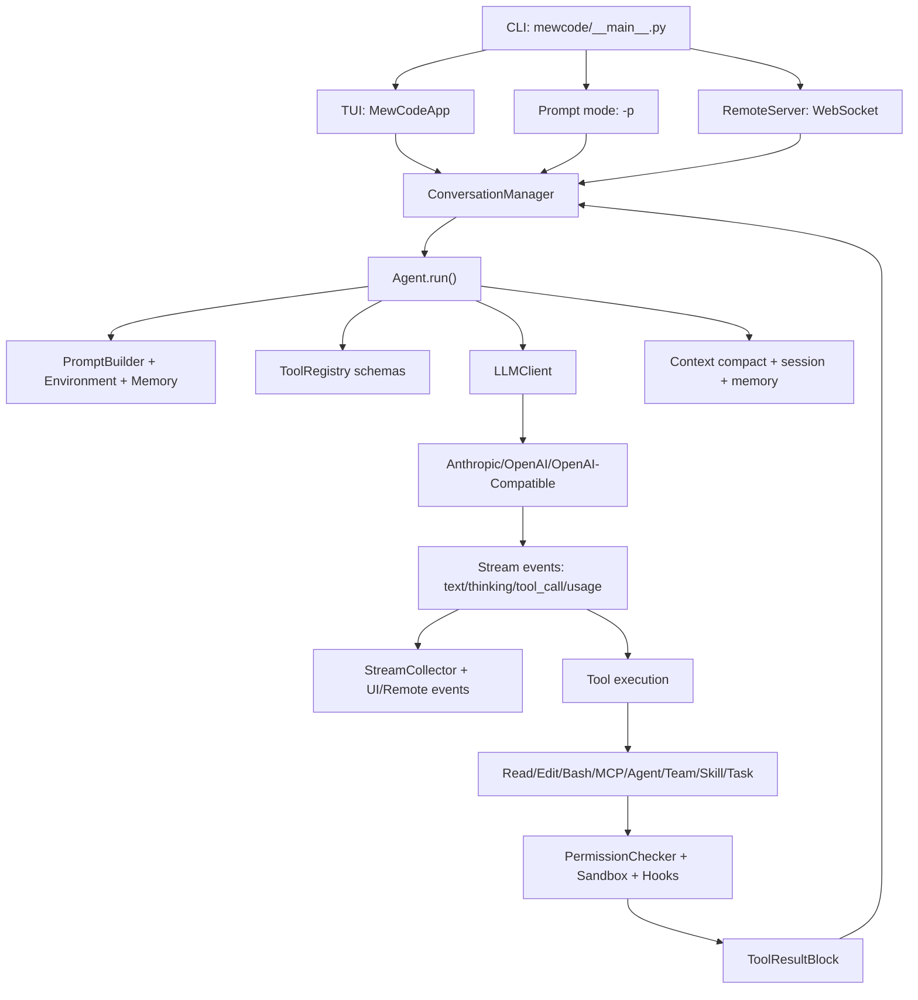

# 当前项目：大厂面试高频问题、追问与参考答案

生成日期：2026-08-17  
项目路径：`D:\zhuomian\mewcode-python`  
项目名称：MewCode  
定位：Python 实现的终端 AI 编程助手，形态接近 Claude Code，核心是多模型 Agent 循环、工具调用、权限控制、上下文管理、MCP 扩展、记忆、子 Agent、团队协作和 Git worktree 隔离。

> 这份文档按“一线互联网大厂资深技术面试官”的视角组织。所有项目能力都以当前源码为准；没有在源码中看到的能力不会包装成已实现能力。

## 0. 真实性审计

### 0.1 已确认的源码事实

- 项目入口在 `mewcode/__main__.py:22` 的 `main()`，支持 TUI、`-p` 非交互模式、`--remote` WebSocket 远程模式和 `--teammate` worker 模式。
- 主 Agent 在 `mewcode/agent.py:297` 的 `Agent`，核心循环在 `mewcode/agent.py:452` 的 `run()`，另有 `run_to_completion()` 供非 UI 场景使用。
- TUI 基于 Textual，主 App 在 `mewcode/app.py:580` 的 `MewCodeApp`。
- 远程模式在 `mewcode/remote.py:69` 的 `RemoteServer`，通过 `websockets` 提供简单 Web UI 和事件流。
- 模型客户端包括 Anthropic、OpenAI Responses API、OpenAI Chat Completions 兼容协议，分别在 `mewcode/client.py:130`、`mewcode/client.py:328`、`mewcode/client.py:453`。
- 会话消息模型在 `mewcode/conversation.py:69` 的 `ConversationManager`，多协议消息适配在 `mewcode/serialization.py`。
- 工具注册中心在 `mewcode/tools/__init__.py:12` 的 `ToolRegistry`，默认工具包括读写文件、编辑文件、Bash、Glob、Grep 和 ToolSearch。
- 权限检查在 `mewcode/permissions/checker.py:26` 的 `PermissionChecker`，包含权限模式、危险命令识别、路径沙箱、规则引擎和人工确认。
- 自动上下文压缩、工具结果溢写和恢复附件在 `mewcode/context/manager.py`。
- 会话持久化在 `mewcode/memory/session.py:400` 的 `SessionManager`，长期记忆在 `mewcode/memory/auto_memory.py:313` 的 `MemoryManager`。
- MCP 管理在 `mewcode/mcp/manager.py:34` 的 `MCPManager`。
- 子 Agent 工具在 `mewcode/tools/agent_tool.py:80` 的 `AgentTool`，Agent 定义加载在 `mewcode/agents/loader.py`。
- worktree 隔离在 `mewcode/worktree/manager.py:35` 的 `WorktreeManager`。
- Hooks 在 `mewcode/hooks/engine.py:25` 的 `HookEngine`。

### 0.2 不应该在面试中夸大的点

- 没有看到 README，`new/spec.md` 是早期 v0.1 规格，仍描述“只支持纯对话、不支持工具调用”的阶段，已经明显落后于当前源码。介绍项目时应以源码为准。
- 没有看到向量数据库、Embedding 检索、RAG 管线、Redis、消息队列、FastAPI、Docker、CI/CD 等实现，不能说“项目已经具备企业级 RAG / 分布式任务队列 / 云原生部署”。
- 记忆系统是文件型记忆加 LLM 选择器，不是向量检索系统。
- 团队协作是本地文件 mailbox、共享任务 JSON 和可选 tmux/iTerm2/in-process worker，不是分布式多机协作系统。
- Hooks 支持 command、prompt、http 等动作，但 `agent` 类型执行器在源码里还是 stub，不能说“Hook 已经能完整启动二级 Agent 工作流”。
- 当前目录执行 `git status` 返回“不是 Git 仓库”。源码实现了 Git worktree 管理，但当前工作区本身未能用 Git 状态验证。

### 0.3 面试简述版本

> MewCode 是我用 Python 做的终端 AI 编程助手。它不是简单包一层 LLM API，而是围绕“Agent 循环”实现了流式模型输出、工具调用、权限确认、上下文压缩、会话恢复、长期记忆、MCP 动态工具、子 Agent、团队协作和 worktree 隔离。主流程是 CLI/TUI/Remote 接收用户请求，ConversationManager 管理历史，Agent 构建系统提示词和工具 schema，Client 适配 Anthropic/OpenAI 协议并流式返回文本、思考和工具调用，再由工具执行器把结果写回对话，形成多轮闭环。

## 1. 项目画像

### 1.1 项目解决什么问题

MewCode 解决的是“开发者在终端里用 AI 读代码、改代码、运行命令、拆分任务和协作完成工程任务”的问题。目标用户是开发者，核心场景包括：

- 在终端中进行 AI 编程对话。
- 让 AI 安全地读取、编辑、搜索项目文件。
- 让 AI 执行 Bash 命令，但对危险命令、越权路径、写操作进行拦截或人工确认。
- 自动管理长上下文，避免大项目对话超过模型窗口。
- 通过 MCP 接入外部工具。
- 通过子 Agent、后台任务、团队成员和 worktree 隔离并行推进复杂任务。
- 支持 TUI、非交互命令和远程 WebSocket 界面。

### 1.2 技术栈

- 语言：Python 3.11+。
- UI：Textual、Rich。
- 异步：asyncio、websockets、httpx。
- 大模型 SDK：anthropic、openai。
- 数据建模：pydantic、dataclasses、PyYAML。
- 扩展协议：MCP Python SDK。
- 本地工程能力：Git worktree、tmux/iTerm2 worker、文件锁、JSONL 会话。
- 测试：pytest，测试覆盖 Agent、上下文、序列化、权限、MCP、记忆、团队和 worktree 等模块。

未发现已实现：数据库、向量库、Docker、CI/CD、LangChain/LangGraph、FastAPI 服务端。

### 1.3 总体架构图

### 1.4 核心数据流

1. `main()` 加载配置、权限模式、Hooks 和模型 provider。
2. TUI/Remote/`-p` 模式创建 `ConversationManager`、`ToolRegistry`、`PermissionChecker` 和 `Agent`。
3. 用户消息进入 `ConversationManager`，必要时展开 `@file`、注入环境、项目指令和记忆。
4. `Agent.run()` 构建系统 prompt、工具 schema 和消息历史。
5. `LLMClient.stream()` 将内部消息模型转成 Anthropic、OpenAI Responses 或 Chat Completions 格式。
6. 模型流式返回文本、thinking、tool call 和 usage。
7. `StreamCollector` 把原始流转为统一事件；并发安全工具可边流式边执行。
8. 工具执行经过权限、参数校验、Hooks、沙箱和错误捕获，结果写成 `ToolResultBlock`。
9. 工具结果再加入对话，触发下一轮模型推理，直到没有工具调用。
10. 会话 JSONL、长期记忆、上下文压缩边界和文件历史被持久化。

## 2. 最值得讲的 15 个技术亮点

1. Agent 循环：将模型推理、工具调用、权限确认、工具结果回填、多轮继续整合为一个事件驱动闭环。
2. 多模型协议适配：内部统一消息模型，外部适配 Anthropic、OpenAI Responses API 和 Chat Completions 兼容协议。
3. 流式输出抽象：把文本、thinking、tool call、usage 统一成事件，便于 TUI、Remote 和非交互模式复用。
4. 流式工具执行：安全工具可以在模型仍在输出时提交执行，减少端到端等待时间。
5. 工具注册与动态发现：`ToolRegistry` 管理内置工具、MCP 工具和 deferred tools，`ToolSearch` 用于按需暴露工具。
6. 权限和安全体系：权限模式、危险命令检测、路径沙箱、读前写校验、本地规则和人工确认共同组成安全边界。
7. 上下文管理：通过 usage anchor 估算 token，工具结果溢写到文件，自动 compact 历史，并附带恢复信息。
8. 会话恢复：JSONL 记录用户、助手、工具调用和 compact boundary，恢复时从最近边界回放。
9. 长期记忆：按用户级和项目级目录存储记忆，通过 LLM 抽取和选择相关记忆。
10. MCP 集成：支持 stdio 和 streamable HTTP MCP server，把外部工具包装成本地 Tool。
11. Skills 机制：项目级、用户级技能热加载，支持 inline 和 fork 模式。
12. 子 Agent 和后台任务：通过 `AgentTool` 运行指定子 Agent，支持后台运行、工具过滤、模型和权限覆盖。
13. 团队协作：通过 team、mailbox、共享任务和 teammate worker 模拟多 Agent 协作。
14. Worktree 隔离：为子任务创建独立 Git worktree，干净时自动清理，有变更时保留。
15. Hooks 扩展点：覆盖会话、轮次、工具、通知、compact 等生命周期，适合审计、拦截和自动化。

## 3. 面试高频问题、追问与参考答案

### Q01：请用 2 分钟介绍一下 MewCode 项目。

- 面试官为什么问：判断你是否真正理解项目边界、用户价值和核心技术。
- 推荐回答：MewCode 是一个 Python 终端 AI 编程助手，围绕 Agent 循环实现模型流式输出、工具调用、权限确认、上下文压缩、会话恢复、MCP 扩展、长期记忆、子 Agent、团队协作和 Git worktree 隔离。它支持 Textual TUI、`-p` 非交互模式和 WebSocket 远程模式。核心不是 UI，而是把“用户请求 -> 模型推理 -> 工具执行 -> 结果回填 -> 多轮继续”做成可控闭环。
- 源码依据：`mewcode/__main__.py:22`，`mewcode/agent.py:297`，`mewcode/app.py:580`，`mewcode/remote.py:69`。
- 可能追问：和简单 ChatGPT CLI 有什么区别？
- 追问参考答案：简单 CLI 通常只是发 prompt 和接文本；MewCode 有工具 schema、权限系统、文件状态保护、上下文 compact、会话和记忆、MCP 动态工具、子 Agent 和团队协作，工程复杂度主要在 Agent 编排和安全边界。

### Q02：这个项目的核心架构是什么？

- 面试官为什么问：考察系统分层能力。
- 推荐回答：可以分为入口层、交互层、Agent 编排层、模型适配层、工具层、安全层、上下文和持久化层。入口层是 `__main__.py`；交互层有 Textual TUI、Remote 和 prompt 模式；Agent 层负责循环编排；Client 层适配不同 LLM 协议；ToolRegistry 管理工具；PermissionChecker 和 sandbox 负责安全；memory/session/context 负责长期运行能力。
- 源码依据：`mewcode/__main__.py`，`mewcode/app.py`，`mewcode/agent.py`，`mewcode/client.py`，`mewcode/tools`，`mewcode/permissions`，`mewcode/context`，`mewcode/memory`。
- 可能追问：为什么不把这些都写在一个主循环里？
- 追问参考答案：因为 UI、模型协议、工具执行、权限、上下文压缩都在变化。分层后 TUI、Remote 和 `-p` 能复用同一个 Agent；新模型和新工具也可以局部扩展。

### Q03：Agent 循环具体怎么运行？

- 面试官为什么问：这是项目最核心的工程能力。
- 推荐回答：`Agent.run()` 每轮会注入环境和记忆，执行 session_start/turn_start/pre_send hook，构建系统 prompt 和工具 schema，必要时自动 compact，然后调用模型流。流式过程中收集文本、thinking、tool call 和 usage。若没有工具调用，则写入 assistant 消息并结束；若有工具调用，则加入 assistant 的 tool_use，执行工具，生成 tool_result 用户消息，再进入下一轮。
- 源码依据：`mewcode/agent.py:452`，`mewcode/conversation.py:69`。
- 可能追问：工具调用结果为什么作为 user 消息写回？
- 追问参考答案：Anthropic 和 OpenAI 的工具协议本质上都要求 tool result 回到下一轮上下文；内部模型把工具结果表示成 `ToolResultBlock`，序列化时再映射到不同协议。

### Q04：你如何抽象不同大模型协议？

- 面试官为什么问：考察接口设计和兼容性。
- 推荐回答：项目内部统一使用 `Message`、`ToolUseBlock`、`ToolResultBlock`、`ThinkingBlock`。对外通过 `serialization.py` 分别构造 Anthropic messages、OpenAI Responses input、Chat Completions messages。Client 层只负责协议调用和流事件解析，Agent 不关心底层是哪家模型。
- 源码依据：`mewcode/conversation.py`，`mewcode/serialization.py`，`mewcode/client.py:130`，`mewcode/client.py:328`，`mewcode/client.py:453`。
- 可能追问：为什么不用一个通用 dict 到处传？
- 追问参考答案：通用 dict 短期快，长期会把协议细节渗透到 Agent。显式 dataclass 能更好表达 tool_use、tool_result、thinking 和 usage，也方便做 pairing 校验和多协议转换。

### Q05：Anthropic、OpenAI Responses、Chat Completions 的工具调用差异怎么处理？

- 面试官为什么问：判断你是否真的接过多模型工具调用。
- 推荐回答：Anthropic 使用内容块中的 `tool_use` 和用户侧 `tool_result`；OpenAI Responses 使用 `function_call` 和 `function_call_output` input item；Chat Completions 使用 assistant `tool_calls` 和 role 为 `tool` 的结果消息。项目在 `serialization.py` 中分别适配，Client 在流解析阶段再把不同事件统一转成 `ToolCallStart/Delta/Complete`。
- 源码依据：`mewcode/serialization.py`，`mewcode/client.py`。
- 可能追问：thinking/reasoning 怎么处理？
- 追问参考答案：内部有 `ThinkingBlock`，Anthropic 解析 thinking delta，OpenAI Responses 解析 reasoning summary，兼容协议读取 `reasoning_content`。

### Q06：如何保证 tool_use 和 tool_result 配对正确？

- 面试官为什么问：工具调用协议很容易因为中断或裁剪历史而损坏。
- 推荐回答：`conversation_pairing.py` 提供 `ensure_tool_pairing()`。它会复制消息历史，给悬空的 tool_use 补一个中断错误结果，同时丢弃没有对应 tool_use 的孤儿 tool_result，保证发给模型的消息满足工具协议。
- 源码依据：`mewcode/conversation_pairing.py`。
- 可能追问：为什么不能直接删掉悬空 tool_use？
- 追问参考答案：直接删可能破坏助手上一轮推理上下文；补一个明确的错误结果更符合“工具调用失败但对话继续”的语义。

### Q07：流式输出是怎么设计的？

- 面试官为什么问：考察异步事件建模。
- 推荐回答：Client 层把 provider 的原始流转成统一事件，例如 `TextDelta`、`ThinkingDelta`、`ToolCallStart`、`ToolCallDelta`、`ToolCallComplete`、`StreamEnd`。Agent 的 `StreamCollector` 再把这些组装成响应对象，同时向 UI 派发 `StreamText`、`ThinkingText`、`ToolUseEvent`、`UsageEvent` 等事件。
- 源码依据：`mewcode/tools/base.py`，`mewcode/agent.py`。
- 可能追问：这样对 UI 有什么好处？
- 追问参考答案：TUI、Remote 和非交互模式只消费统一事件，不需要理解 Anthropic 或 OpenAI 的原始流格式。

### Q08：工具为什么可以边流式边执行？

- 面试官为什么问：考察性能优化意识。
- 推荐回答：项目里有 `StreamingExecutor`。当模型流式产生一个完整 tool call 后，如果该工具无需人工权限确认，就可以立即提交执行。Agent 会继续消费模型流，同时后台执行工具，最后按原始 tool call 顺序收集结果。
- 源码依据：`mewcode/agent.py` 的 `StreamingExecutor` 和 `run()`。
- 可能追问：并发执行会不会打乱结果顺序？
- 追问参考答案：执行可以并发，但结果按 tool call 原始顺序回填，避免模型看到乱序结果。

### Q09：哪些工具适合并发，哪些不适合？

- 面试官为什么问：考察副作用控制。
- 推荐回答：读类工具如 ReadFile、Glob、Grep 通常可并发；写文件、编辑文件、执行命令通常有副作用，不应随意并发。Tool 基类提供 `is_concurrency_safe` 标记，Agent 根据工具安全性和权限判断是否可提前执行。
- 源码依据：`mewcode/tools/base.py`，`mewcode/tools/read_file.py`，`mewcode/tools/glob_tool.py`，`mewcode/tools/grep_tool.py`。
- 可能追问：Bash 能不能并发？
- 追问参考答案：默认应谨慎，因为命令可能修改文件、启动服务或占用资源；除非有明确沙箱和副作用约束，否则不能当作普通读操作。

### Q10：ToolRegistry 的作用是什么？

- 面试官为什么问：考察可扩展性设计。
- 推荐回答：`ToolRegistry` 是工具中心，负责注册、禁用、发现、查询工具 schema，并将 schema 转换为不同模型协议需要的形态。默认注册文件和命令工具，后续可以注册 MCP、Agent、Team、Skill、Task 等工具。
- 源码依据：`mewcode/tools/__init__.py:12`。
- 可能追问：为什么要有 deferred tool？
- 追问参考答案：MCP 或大量工具一次性暴露会污染 prompt、浪费 token，并增加误调用风险。deferred 工具通过 ToolSearch 按需发现。

### Q11：内置文件工具有哪些安全保护？

- 面试官为什么问：AI 编程助手最大的风险之一是误改文件。
- 推荐回答：ReadFile 会记录文件 mtime；WriteFile 和 EditFile 在覆盖已有文件前会检查是否读过且未被外部修改；EditFile 要求 `old_string` 唯一匹配，并返回 diff。这样能降低模型基于陈旧内容改文件的风险。
- 源码依据：`mewcode/tools/read_file.py`，`mewcode/tools/write_file.py`，`mewcode/tools/edit_file.py`，`mewcode/tools/file_cache.py`。
- 可能追问：为什么 EditFile 要求 old_string 唯一？
- 追问参考答案：如果不唯一，模型可能改错位置；要求唯一可以把歧义暴露出来，让模型先读更多上下文或改用更精确片段。

### Q12：Bash 工具如何控制风险？

- 面试官为什么问：命令执行是高风险能力。
- 推荐回答：Bash 工具本身支持 timeout，最长限制 600 秒，并可接入 OS sandbox wrapper。更重要的是执行前经过 `PermissionChecker`，危险命令直接拒绝，安全读命令可放行，其他命令根据权限模式、规则和用户确认决定。
- 源码依据：`mewcode/tools/bash.py`，`mewcode/permissions/checker.py`，`mewcode/permissions/dangerous.py`。
- 可能追问：当前 Bash 有什么不足？
- 追问参考答案：源码里 `_interpret_exit_code` 存在但没有真正用于设置 `is_error`，非零退出码主要作为文本提示返回，这会影响上层对命令失败的结构化判断。

### Q13：权限系统有哪些层？

- 面试官为什么问：考察安全架构。
- 推荐回答：权限系统包括权限模式、危险命令检测、路径沙箱、本地 allow/deny 规则、session allow-always、人工确认、plan mode 特例和工具类别。读、写、命令有不同默认策略，plan mode 下只允许写计划文件。
- 源码依据：`mewcode/permissions/modes.py`，`mewcode/permissions/checker.py`，`mewcode/permissions/rules.py`，`mewcode/permissions/sandbox.py`。
- 可能追问：bypassPermissions 是不是危险？
- 追问参考答案：是，所以它只适合受信任自动化或内部 worker。面试中要强调默认模式不是 bypass，且有危险命令和路径限制。

### Q14：路径沙箱如何实现？

- 面试官为什么问：考察文件系统安全细节。
- 推荐回答：`PathSandbox` 会把目标路径 resolve 到真实路径，检查是否位于允许根目录下，并对写操作阻止敏感路径，例如配置、权限本地文件和技能目录。这样可以防止相对路径和符号链接绕过。
- 源码依据：`mewcode/permissions/sandbox.py`，`mewcode/permissions/checker.py`。
- 可能追问：为什么要 resolve？
- 追问参考答案：不 resolve 的话，`../`、符号链接和大小写差异可能绕过目录限制，实际写到项目外。

### Q15：plan mode 是怎么做的？

- 面试官为什么问：考察产品模式和权限联动。
- 推荐回答：plan mode 本质是一个更保守的权限模式，只允许读、Agent、ToolSearch、AskUserQuestion、ExitPlanMode 等能力，WriteFile/EditFile 只允许修改计划文件。这样可以让模型先产出计划，不直接改业务代码。
- 源码依据：`mewcode/permissions/checker.py`，`mewcode/permissions/modes.py`，`mewcode/tools/exit_plan_mode.py`。
- 可能追问：为什么 plan mode 不是只靠 prompt 约束？
- 追问参考答案：prompt 只能软约束，权限检查是硬约束。AI 编程助手涉及文件写入，必须用代码层防线。

### Q16：上下文窗口怎么估算？

- 面试官为什么问：长上下文是 Agent 工程常见难点。
- 推荐回答：ProviderConfig 支持显式 context_window、远程模型元数据、内置模型映射和默认 fallback。ConversationManager 用 usage anchor 记录最近一次真实 token 用量，后续只估算新增尾部内容，避免每轮全量估算。
- 源码依据：`mewcode/config.py`，`mewcode/validator.py`，`mewcode/conversation.py`。
- 可能追问：为什么不能全靠字符数估算？
- 追问参考答案：字符数估算误差大，尤其有工具 schema、cache token 和不同语言时。usage anchor 用真实 API usage 校准，字符估算只用于增量部分。

### Q17：自动 compact 触发逻辑是什么？

- 面试官为什么问：考察长任务稳定性。
- 推荐回答：`auto_compact()` 会根据当前 token、模型窗口、保留区和 margin 判断是否需要压缩。触发后保留最近消息，把前缀交给模型总结，重建历史为 summary message 加最近 tail，并附加恢复附件。
- 源码依据：`mewcode/context/manager.py`。
- 可能追问：compact 失败怎么办？
- 追问参考答案：有 `CompactCircuitBreaker` 控制连续失败次数，失败时不会无限重试，避免在边界条件下陷入压缩循环。

### Q18：工具结果太大怎么办？

- 面试官为什么问：工具输出是上下文爆炸的主要来源。
- 推荐回答：单个大工具结果超过阈值会持久化到 session 的 tool-results 目录，conversation 中只保留预览和路径标签。聚合工具结果超过预算时，会优先溢写最大结果，避免一次 grep 或命令输出撑爆上下文。
- 源码依据：`mewcode/context/manager.py`，`mewcode/agent.py` 的 `_maybe_persist_or_truncate()`。
- 可能追问：模型后续要看完整结果怎么办？
- 追问参考答案：项目有 spill readback 机制，允许模型再读取持久化文件，并对这类读取做预算豁免。

### Q19：RecoveryState 解决什么问题？

- 面试官为什么问：考察 compact 后的可恢复性。
- 推荐回答：compact 后历史前缀被总结，细节可能丢失。RecoveryState 会记录最近读取过的重要文件和技能调用，在 compact 后生成恢复附件，让模型继续任务时能看到关键文件快照、已激活技能和工具 schema。
- 源码依据：`mewcode/context/manager.py`，`mewcode/agent.py`。
- 可能追问：为什么不能完全依赖 summary？
- 追问参考答案：summary 适合保留意图和状态，但代码细节、精确片段和工具 schema 更适合结构化附件。

### Q20：会话如何持久化和恢复？

- 面试官为什么问：AI 编程助手要支持长任务和重启恢复。
- 推荐回答：SessionManager 使用 JSONL 存储消息记录，包含用户、助手、工具调用和工具结果。遇到 compact 会写入 `compact_boundary`，恢复时从最近边界加载 summary 和保留消息，而不是从头塞完整历史。
- 源码依据：`mewcode/memory/session.py:400`。
- 可能追问：为什么选择 JSONL？
- 追问参考答案：JSONL 追加写简单、易调试、适合流式记录会话；对本地 CLI 项目比引入数据库更轻量。

### Q21：长期记忆系统怎么做的？

- 面试官为什么问：考察个性化和跨会话能力。
- 推荐回答：长期记忆分用户级和项目级目录，文件带 frontmatter，并维护 `MEMORY.md` 索引。模型可以在会话结束或轮次结束时抽取记忆，后续请求通过 recall selector 挑选相关记忆注入对话。
- 源码依据：`mewcode/memory/auto_memory.py`，`mewcode/memory/recall.py`。
- 可能追问：这是 RAG 吗？
- 追问参考答案：不是典型向量 RAG。它没有 embedding 和向量库，是文件型记忆加 LLM 选择器。

### Q22：长期记忆有什么已知问题？

- 面试官为什么问：考察你是否能坦诚评估项目。
- 推荐回答：一个明显问题是抽取时写入的 frontmatter 把 `type` 放在 `metadata.type` 下，但解析逻辑倾向读取顶层 `type`，可能导致后续按类型加载记忆不准确。这个问题适合通过统一 frontmatter schema 和迁移测试修复。
- 源码依据：`mewcode/memory/auto_memory.py`。
- 可能追问：你会怎么修？
- 追问参考答案：先让 parser 兼容 `type` 和 `metadata.type`，再把 extract 写入格式改为统一 schema，补一组旧文件兼容和新文件生成测试。

### Q23：MCP 是怎么接入的？

- 面试官为什么问：MCP 是 Agent 工具生态的重要扩展方式。
- 推荐回答：配置中定义 MCP server，可以是 stdio，也可以是 streamable HTTP。MCPManager 连接 server，读取 instructions 和 tool list，再用 MCPToolWrapper 把远端工具包装成本地 Tool 注册到 ToolRegistry。
- 源码依据：`mewcode/mcp/manager.py:34`，`mewcode/mcp/client.py`，`mewcode/mcp/tool_wrapper.py`。
- 可能追问：MCP 工具为什么 should_defer？
- 追问参考答案：外部工具可能数量多、schema 长、权限风险更高，默认延迟暴露可以降低 prompt 成本和误调用概率。

### Q24：MCP 这一块有什么潜在 bug？

- 面试官为什么问：看你是否做过源码级审计。
- 推荐回答：MCPToolWrapper 生成的工具名形如 `mcp_{server}_{tool}`，但工具过滤里的 `_is_mcp_tool()` 判断前缀是 `mcp__` 双下划线。这可能导致某些基于 MCP 识别的过滤逻辑失效。
- 源码依据：`mewcode/mcp/tool_wrapper.py`，`mewcode/agents/tool_filter.py`。
- 可能追问：影响是什么？
- 追问参考答案：子 Agent 或 coordinator 的工具白名单/黑名单可能没有按 MCP 工具预期生效，应统一命名规则并补过滤测试。

### Q25：ToolSearch 解决什么问题？

- 面试官为什么问：考察 prompt token 成本意识。
- 推荐回答：当工具很多时，一次性把全部工具 schema 放进 prompt 会浪费 token，也会让模型容易选错工具。ToolSearch 让模型先按关键词或 `select:name` 找工具，命中后标记 discovered，再暴露 schema。
- 源码依据：`mewcode/tools/tool_search.py`，`mewcode/tools/__init__.py`。
- 可能追问：为什么不直接用向量搜索？
- 追问参考答案：当前工具数量和描述规模不一定需要向量化，关键词加显式 select 足够简单可控。以后工具规模更大时可以演进为 embedding 检索。

### Q26：Skills 机制是什么？

- 面试官为什么问：考察 prompt 复用和能力扩展。
- 推荐回答：Skills 是可热加载的能力说明，来源包括项目 `.mewcode/skills` 和用户 `~/.mewcode/skills`。格式支持 Markdown frontmatter、`skill.yaml + prompt.md`、`SKILL.md`。LoadSkill 可把 skill 激活为 inline prompt，也支持 fork 模式交给子 Agent 执行。
- 源码依据：`mewcode/skills/loader.py`，`mewcode/skills/parser.py`，`mewcode/tools/load_skill.py`。
- 可能追问：inline 和 fork 有什么区别？
- 追问参考答案：inline 把技能说明注入当前 Agent 上下文；fork 会创建独立 Agent 执行技能任务，适合重任务或需要隔离上下文的场景。

### Q27：Skills fork 有什么风险？

- 面试官为什么问：考察你对自己项目短板的掌握。
- 推荐回答：`SkillExecutor._build_fork_context()` 里读取的是 `self.agent._conversation`，但 Agent 运行时设置的是 `_current_conversation`。这可能导致 fork skill 没拿到预期上下文，是一个需要修复的字段名不一致问题。
- 源码依据：`mewcode/skills/executor.py`，`mewcode/agent.py`。
- 可能追问：如何避免这类问题？
- 追问参考答案：把当前 conversation 暴露为明确属性或 getter，禁止模块直接访问私有字段，并补一条 fork skill 继承上下文的端到端测试。

### Q28：子 Agent 是怎么实现的？

- 面试官为什么问：多 Agent 是高频追问点。
- 推荐回答：`AgentTool` 接收 task、subagent_type、是否后台、权限模式、模型等参数。它根据 AgentDef 加载子 Agent 的系统提示词、工具白名单/黑名单、最大轮数和隔离模式，然后新建 Agent 运行。后台任务交给 TaskManager。
- 源码依据：`mewcode/tools/agent_tool.py:80`，`mewcode/agents/loader.py`，`mewcode/agents/task_manager.py`。
- 可能追问：父 Agent 和子 Agent 的上下文如何传递？
- 追问参考答案：普通子 Agent 用任务描述和必要上下文；fork 模式会复制父 conversation，并插入 fork boilerplate，避免子 Agent 完全失忆。

### Q29：子 Agent 如何限制能力？

- 面试官为什么问：考察权限收敛和上下文隔离。
- 推荐回答：AgentDef 可以配置 tools、disallowedTools、permissionMode、model、maxTurns、isolation 等。工具过滤器会移除危险或不适合子 Agent 的工具，例如防止嵌套 fork，背景任务也有单独白名单。
- 源码依据：`mewcode/agents/parser.py`，`mewcode/agents/tool_filter.py`，`mewcode/tools/agent_tool.py`。
- 可能追问：为什么要限制嵌套 Agent？
- 追问参考答案：无限递归会造成成本失控、上下文污染和权限扩散。工程上必须限制 Agent 自我复制能力。

### Q30：团队协作模式是怎么设计的？

- 面试官为什么问：考察复杂 Agent 协作建模。
- 推荐回答：TeamManager 在用户目录下维护 team 配置、成员、任务和 inbox。teammate worker 可以是 in-process、tmux 或 iTerm2。成员之间通过 mailbox 传消息，通过共享任务 JSON 协调任务状态，Lead Agent 通过 SendMessage、TaskCreate/Get/List/Update 和 TaskStop 协作。
- 源码依据：`mewcode/teams/manager.py`，`mewcode/teams/mailbox.py`，`mewcode/teams/shared_task.py`，`mewcode/__main__.py` 的 teammate 模式。
- 可能追问：它是分布式系统吗？
- 追问参考答案：不是。它是本地多 worker 协作，mailbox 是本地 JSON 文件和文件锁，不具备跨机器一致性和高并发队列能力。

### Q31：团队模式有哪些一致性风险？

- 面试官为什么问：考察并发系统意识。
- 推荐回答：mailbox 有锁和 stale lock 处理，但共享任务 store 是 JSON 文件，源码里没有看到同等强度的文件锁保护。多 worker 高频写任务状态时可能有竞争风险。这个阶段适合本地低并发，不适合宣称为生产级队列。
- 源码依据：`mewcode/teams/mailbox.py`，`mewcode/teams/shared_task.py`。
- 可能追问：如何升级？
- 追问参考答案：短期给 shared task 加原子写和锁；长期可以接 SQLite、Redis stream 或真正任务队列，并引入任务版本号做乐观并发控制。

### Q32：worktree 隔离解决什么问题？

- 面试官为什么问：AI 改代码需要隔离风险。
- 推荐回答：子 Agent 或团队成员可以在独立 Git worktree 里工作，避免直接污染主工作区。WorktreeManager 负责创建分支和 worktree、进入/退出会话、干净时自动清理、有未提交变更时保留。
- 源码依据：`mewcode/worktree/manager.py:35`，`mewcode/tools/agent_tool.py`。
- 可能追问：为什么不用直接复制目录？
- 追问参考答案：Git worktree 更轻量，保留 Git 历史和分支语义，也便于后续 diff、提交、合并和清理。

### Q33：当前 worktree 能力有什么运行前提？

- 面试官为什么问：考察你是否区分源码能力和环境事实。
- 推荐回答：它依赖当前项目是 Git 仓库，并且能执行 `git worktree`。当前工作区执行 `git status` 显示不是 Git 仓库，因此源码能力存在，但这个具体目录下需要先初始化或放在真实 Git 仓库中才能完整验证。
- 源码依据：`mewcode/worktree/manager.py`，本次本地命令验证。
- 可能追问：面试时怎么说不尴尬？
- 追问参考答案：坦诚说“源码实现了该能力，但当前目录状态未满足运行前提；我会通过测试仓库做 E2E 验证”。不要硬说已经在当前项目跑通。

### Q34：Hooks 的设计价值是什么？

- 面试官为什么问：考察扩展点和可观测性。
- 推荐回答：HookEngine 支持在 session、turn、tool、notification、compact 等生命周期触发 command、prompt、http 等动作。它能用于审计、工具拦截、系统提示增强、外部通知和自动化。
- 源码依据：`mewcode/hooks/engine.py:25`，`mewcode/hooks/loader.py`，`mewcode/hooks/executors.py`。
- 可能追问：Hook 能拒绝工具调用吗？
- 追问参考答案：可以，pre_tool_use hook 支持 reject；但 async hook 不适用于 pre_tool_use，因为拒绝必须同步影响工具执行。

### Q35：Hooks 有哪些不能夸大的地方？

- 面试官为什么问：考察真实性。
- 推荐回答：`agent` 类型 hook executor 在源码中仍是 stub，只返回未实现提示。因此当前可讲 command、prompt、http 等执行器，不应说 hook 已完整支持自动启动 Agent。
- 源码依据：`mewcode/hooks/executors.py`。
- 可能追问：后续怎么补？
- 追问参考答案：复用 `AgentTool` 或内部 TaskManager，把 hook 上下文转成任务输入，并加权限和递归限制，防止 hook 触发 Agent 后再触发 hook 无限循环。

### Q36：Remote 模式怎么工作？

- 面试官为什么问：考察多端复用和服务端事件流。
- 推荐回答：RemoteServer 使用 websockets 提供 HTTP 页面和 `/ws` 通道。收到 user_message 后复用 Agent 逻辑，向前端广播 stream_text、thinking、tool_use、tool_result、permission、usage、error、compact 等事件。
- 源码依据：`mewcode/remote.py:69`。
- 可能追问：Remote 和 TUI 是否共享核心逻辑？
- 追问参考答案：共享 Agent、ConversationManager、ToolRegistry、PermissionChecker、Client 和 memory/session 逻辑，只是事件消费和展示不同。

### Q37：TUI 的核心职责是什么？

- 面试官为什么问：考察 UI 和业务分离。
- 推荐回答：TUI 负责输入框、命令补全、文件引用展开、模型选择、权限确认 UI、流式渲染、session 命令和状态展示。真正的推理和工具闭环在 Agent 中，所以 Remote 和 `-p` 能复用。
- 源码依据：`mewcode/app.py:580`，`mewcode/app.py` 的 `_send_message()`。
- 可能追问：为什么选择 Textual？
- 追问参考答案：Textual 适合终端交互应用，支持异步 UI、组件化、键盘事件和丰富文本渲染，比手写 curses 更工程化。

### Q38：`-p` 非交互模式有什么价值？

- 面试官为什么问：考察自动化场景。
- 推荐回答：`-p` 可以把 MewCode 作为命令行自动化工具使用，输入一次 prompt，输出 text 或 stream-json。它构造非交互 Agent，权限默认自动批准当前请求中的 permission request，适合脚本和 CI 风格调用。
- 源码依据：`mewcode/__main__.py` 的 `_run_prompt()`。
- 可能追问：自动批准会不会危险？
- 追问参考答案：会，所以要结合 permission mode、工作目录和使用场景。生产上应限制命令、沙箱和凭证，不建议随意 bypass。

### Q39：配置系统如何设计？

- 面试官为什么问：考察产品可用性。
- 推荐回答：`load_config()` 从用户级、项目级和本地覆盖配置加载 YAML，并做深合并。ProviderConfig 支持不同协议、base_url、model、thinking、context_window、max_output_tokens 和 API key 环境变量 fallback。
- 源码依据：`mewcode/config.py:250`，`mewcode/validator.py`。
- 可能追问：为什么有 config.local.yaml？
- 追问参考答案：本地覆盖适合存放个人机器或私密配置，不应该进入团队共享配置。

### Q40：项目指令如何加载？

- 面试官为什么问：考察 prompt 工程和项目上下文。
- 推荐回答：指令加载器会读取用户级和项目级 `MEWCODE.md`、`AGENTS.md`、`.mewcode/INSTRUCTIONS.md`、`MEWCODE.local.md` 等，并支持 `@./path` include、深度限制和循环检测。这样项目规范能进入系统提示词。
- 源码依据：`mewcode/memory/instructions.py`。
- 可能追问：为什么 include 要跳过 fenced code？
- 追问参考答案：避免代码块里出现的 `@xxx` 被误认为 include 指令。

### Q41：项目如何处理 API 错误和输出截断？

- 面试官为什么问：长任务一定会遇到模型异常。
- 推荐回答：Client 层把认证、限流、网络和 HTTP 状态错误映射成自定义异常。Agent 遇到 `max_tokens` 会先提升 max_output_tokens，再有限次数追加恢复提示继续生成；超过次数后进入错误事件。
- 源码依据：`mewcode/client.py`，`mewcode/agent.py`。
- 可能追问：有没有完整重试退避？
- 追问参考答案：目前有部分错误分类和 max_tokens 恢复，但不是完整的通用指数退避和熔断体系。这是后续稳定性优化点。

### Q42：测试覆盖情况如何？

- 面试官为什么问：考察工程质量。
- 推荐回答：项目有 pytest 测试，覆盖 Agent loop、工具结果配对、序列化、上下文 compact、权限、MCP、记忆、指令加载、团队、worktree 和 hook 等模块。测试更偏核心逻辑单元和部分集成，不等于所有 TUI/Remote E2E 都完全覆盖。
- 源码依据：`tests/` 目录。
- 可能追问：最应该补什么测试？
- 追问参考答案：补真实 TUI/Remote 的端到端工具调用、MCP 命名过滤、memory frontmatter 兼容、skill fork 上下文、Bash 非零退出码结构化错误。

### Q43：这个项目最难的工程点是什么？

- 面试官为什么问：看你是否抓住复杂度核心。
- 推荐回答：最难的是让长任务 Agent 闭环稳定运行。它涉及多协议流式输出、工具调用配对、权限中断、工具并发、上下文压缩、会话恢复和 UI 渲染的一致性。任何一个环节丢状态，都可能导致模型无法继续。
- 源码依据：`mewcode/agent.py`，`mewcode/conversation_pairing.py`，`mewcode/context/manager.py`。
- 可能追问：你如何降低复杂度？
- 追问参考答案：用统一内部事件和消息模型隔离 provider 差异；用 ToolRegistry 和 PermissionChecker 隔离工具和安全；用 context/session 模块隔离长上下文和恢复。

### Q44：你如何描述这个项目里的 Agent？

- 面试官为什么问：避免候选人空泛讲“智能体”。
- 推荐回答：这里的 Agent 不是神秘概念，而是一个带状态的异步控制器：维护对话历史，构建 prompt，调用模型，解析 tool call，检查权限，执行工具，把结果回填，并决定是否继续循环。
- 源码依据：`mewcode/agent.py:297`，`mewcode/agent.py:452`。
- 可能追问：和 LangGraph 有什么区别？
- 追问参考答案：MewCode 没用 LangGraph，是手写控制循环。优势是贴合产品和协议细节，劣势是图状态、重试和可视化编排需要自己维护。

### Q45：这个项目里的 memory 和 session 有什么区别？

- 面试官为什么问：很多人会混淆短期上下文和长期记忆。
- 推荐回答：session 是当前或历史对话的逐轮记录，用于恢复任务；memory 是跨会话的长期知识，例如用户偏好、项目事实、反馈和参考信息。session 是事件日志，memory 是抽取后的可复用知识。
- 源码依据：`mewcode/memory/session.py`，`mewcode/memory/auto_memory.py`。
- 可能追问：compact summary 属于哪一类？
- 追问参考答案：compact boundary 属于 session 内部恢复机制，不是长期记忆。

### Q46：如何支持用户输入中的文件引用？

- 面试官为什么问：考察终端 AI 编程产品细节。
- 推荐回答：TUI 输入层支持 `@file` 引用展开，把文件内容作为上下文加入请求。这样用户可以显式指定相关文件，减少模型盲目搜索。
- 源码依据：`mewcode/app.py`。
- 可能追问：这和 ReadFile 工具有什么区别？
- 追问参考答案：`@file` 是用户主动提供上下文，ReadFile 是模型在工具循环中主动读取；前者更直接，后者更适合探索。

### Q47：为什么要有 SyntheticOutput 工具？

- 面试官为什么问：考察结构化输出设计。
- 推荐回答：SyntheticOutput 让 Agent 可以返回结构化 JSON 或字符串，并做浅层 schema 校验。它适合内部自动化、子任务结果汇总或非交互模式中需要稳定格式的场景。
- 源码依据：`mewcode/tools/synthetic_output.py`。
- 可能追问：浅层校验有什么不足？
- 追问参考答案：只能检查基础类型和 required，不能代替完整 JSON Schema 校验。复杂结构应引入更完整校验库或 Pydantic 模型。

### Q48：任务管理 TaskManager 的职责是什么？

- 面试官为什么问：考察后台任务模型。
- 推荐回答：TaskManager 管理后台子 Agent 的生命周期、状态、进度、结果和通知。父 Agent 可以发起后台任务，后续通过通知队列拿到完成事件。
- 源码依据：`mewcode/agents/task_manager.py`。
- 可能追问：后台任务如何避免父 Agent 等太久？
- 追问参考答案：后台任务用 asyncio task 运行，父 Agent 先返回 task id，后续通过通知或查询获取结果。

### Q49：Coordinator mode 是什么？

- 面试官为什么问：考察多 Agent 角色设计。
- 推荐回答：Coordinator mode 让 Lead Agent 更像协调者，工具白名单限制在 Agent、SendMessage、TaskStop、SyntheticOutput、TeamDelete 等协作工具，避免 Lead 自己消耗大量上下文直接读写代码。
- 源码依据：`mewcode/agents/tool_filter.py`，`mewcode/agent.py`。
- 可能追问：为什么要限制 Lead 读代码？
- 追问参考答案：团队模式下 Lead 的价值是拆分、分派、整合和决策。让 Lead 直接探索大量代码会挤占上下文，也破坏分工。

### Q50：MewCode 的安全边界有哪些还不够？

- 面试官为什么问：安全是 AI coding agent 必问。
- 推荐回答：已有危险命令、路径沙箱、权限模式、规则、读前写保护和人工确认。但不足包括 Bash 非零退出码结构化错误不完整、OS sandbox 能力依赖平台和配置、MCP 外部工具权限需要更细粒度声明、团队任务存储不是生产级并发模型。
- 源码依据：`mewcode/permissions`，`mewcode/tools/bash.py`，`mewcode/mcp`，`mewcode/teams`。
- 可能追问：优先修哪个？
- 追问参考答案：优先补 Bash 退出码和 MCP 工具权限分级，因为它们直接影响错误判断和外部工具安全。

### Q51：如果让你优化性能，你会从哪里下手？

- 面试官为什么问：考察工程优化路线。
- 推荐回答：第一是减少 prompt token：deferred tools、memory recall、compact 和工具结果溢写；第二是降低等待：流式工具执行、并发读工具；第三是减少重复 IO：文件状态缓存和会话增量追加；第四是避免不必要的模型调用：更精确的工具选择和命令。
- 源码依据：`mewcode/tools/tool_search.py`，`mewcode/context/manager.py`，`mewcode/agent.py`。
- 可能追问：能不能做工具调用缓存？
- 追问参考答案：只适合纯读且输入稳定的工具，例如 Glob/Grep/ReadFile；写操作和 Bash 不能简单缓存。

### Q52：如果让你优化稳定性，你会怎么做？

- 面试官为什么问：考察生产化意识。
- 推荐回答：补全 LLM 调用重试和退避，完善结构化错误码；为 Remote/TUI 增加 E2E 测试；统一 MCP 命名；修复 memory schema 和 skill fork 上下文；为 team shared task 加锁；把关键事件落日志或 trace。
- 源码依据：`mewcode/client.py`，`mewcode/agent.py`，`mewcode/memory`，`mewcode/skills`，`mewcode/teams`。
- 可能追问：先做哪个里程碑？
- 追问参考答案：先做“稳定工具调用闭环”，因为它是所有上层能力的基础。

### Q53：如果面试官问你项目规模，你怎么回答？

- 面试官为什么问：判断是不是 toy project。
- 推荐回答：它不是只有一个 CLI wrapper，而是多模块工程，包含 Agent、Client、Tool、Permission、Context、Memory、MCP、Skills、Agents、Teams、Worktree、Hooks、TUI、Remote 和 Tests。更接近本地开发者工具和 LLM Agent runtime 的组合。
- 源码依据：`mewcode/` 包结构和 `tests/`。
- 可能追问：核心代码你最熟哪块？
- 追问参考答案：建议重点说 Agent 循环、工具调用和上下文压缩，因为这是项目含金量最高的部分。

### Q54：这个项目适合投哪些岗位？

- 面试官为什么问：考察项目与岗位匹配度。
- 推荐回答：最适合 AI 应用开发、Agent Engineer、AI coding 工具、开发者工具、Python 后端、LLM Platform 应用层岗位。对 RAG 岗位有部分相关性，但需要补 embedding/vector retrieval。对底层算法岗相关性较弱。
- 源码依据：项目实现范围。
- 可能追问：如何让它更适合 RAG 岗？
- 追问参考答案：增加文档切分、embedding、向量库、召回排序、引用溯源和评测集，把 memory recall 演进成真正检索系统。

### Q55：这个项目最能体现你的能力的三个点是什么？

- 面试官为什么问：让你提炼个人贡献。
- 推荐回答：第一是 Agent 闭环工程化，把流式模型、工具、权限和上下文整合起来；第二是安全可控的工具执行，包含文件状态、危险命令、路径沙箱和人工确认；第三是长任务能力，包括 compact、session、memory、子 Agent 和 worktree。
- 源码依据：`mewcode/agent.py`，`mewcode/permissions`，`mewcode/context`，`mewcode/memory`，`mewcode/tools/agent_tool.py`。
- 可能追问：你会如何证明？
- 追问参考答案：用端到端 demo：让 MewCode 读一个模块、改一个小 bug、运行测试、触发权限确认、展示 session 恢复和 compact 或 worktree 子任务。

### Q56：为什么没有直接使用 LangChain 或 LangGraph？

- 面试官为什么问：考察技术选型。
- 推荐回答：这个项目需要非常贴近终端 AI 编程助手的控制细节，例如 provider 流式事件、工具结果配对、权限确认中断、文件编辑保护、compact boundary、TUI 渲染和 MCP deferred tools。手写 runtime 能更精细地控制这些细节。代价是状态图、重试和观测需要自己实现。
- 源码依据：自研 `Agent`、`ToolRegistry`、`PermissionChecker`、`ContextManager`。
- 可能追问：未来会接 LangGraph 吗？
- 追问参考答案：如果团队需要标准图编排、可视化和持久状态机，可以把部分流程迁移；但核心工具安全和终端交互仍需保留自定义层。

### Q57：如何处理模型输出中的 max_tokens 截断？

- 面试官为什么问：LLM 长输出经常被截断。
- 推荐回答：Agent 检测 stream end reason，如果是 max_tokens，会先尝试提升输出 token 上限，再追加系统式用户消息要求模型从中断处继续。恢复次数有限，避免无限循环。
- 源码依据：`mewcode/agent.py`。
- 可能追问：为什么不是直接重试整轮？
- 追问参考答案：整轮重试成本高，也可能重复执行工具。续写能保留已有文本和工具状态，但需要限制次数和清晰提示。

### Q58：如何解释“读前写”机制？

- 面试官为什么问：这是 AI 编辑器安全性的重要细节。
- 推荐回答：在写入或编辑已有文件前，要求模型先 ReadFile，记录文件 mtime。写入时检查文件是否在读取后被外部修改。如果文件变了，就拒绝写入，要求重新读取。这类似乐观并发控制。
- 源码依据：`mewcode/tools/file_cache.py`，`mewcode/tools/write_file.py`，`mewcode/tools/edit_file.py`。
- 可能追问：它能防止所有冲突吗？
- 追问参考答案：不能。它防的是读取后外部修改导致的陈旧写入；对语义冲突、并发命令副作用仍需要测试和人工 review。

### Q59：如果模型调用工具时参数不合法怎么办？

- 面试官为什么问：工具参数来自模型，必须不可信。
- 推荐回答：每个 Tool 有 Pydantic 参数模型。Agent 执行前会用 `model_validate()` 校验参数，失败返回结构化错误 ToolResult，而不是让异常穿透。
- 源码依据：`mewcode/tools/base.py`，`mewcode/agent.py`。
- 可能追问：为什么错误也要回给模型？
- 追问参考答案：模型可以根据错误修正参数继续调用工具，这是 Agent 闭环的一部分。

### Q60：如果你要把项目讲成一个 STAR 案例，怎么讲？

- 面试官为什么问：考察表达和项目包装能力。
- 推荐回答：S：开发者在终端使用 LLM 时缺少安全可控的代码操作能力。T：我希望做一个能读写代码、运行命令、长期对话并支持扩展工具的 AI 编程助手。A：我设计了统一消息模型、Agent 循环、工具注册和权限系统，接入多模型协议、MCP、上下文 compact、session/memory、子 Agent 和 worktree。R：项目形成了一个完整的本地 AI coding runtime，而不是单纯 API wrapper。
- 源码依据：全项目结构。
- 可能追问：结果有没有量化？
- 追问参考答案：当前源码层面可以用测试覆盖、端到端任务成功率、平均 token 成本、工具调用成功率、compact 后恢复成功率来量化；如果没有真实统计，不要虚构数字。

## 4. 面试官追问链

### 追问链 A：Agent 循环

1. Agent 是什么？
2. MewCode 的 Agent 状态有哪些？
3. 工具调用如何回填？
4. 流式 tool call 如何收集完整参数？
5. 工具执行失败如何让模型恢复？
6. 如果中途 Ctrl-C 呢？

推荐答题路径：先定义 Agent 为异步控制器，再讲 Message/ToolUse/ToolResult，然后讲 StreamCollector 和 pairing，最后讲错误 ToolResult、session 记录和恢复。

### 追问链 B：安全

1. AI 能执行命令，怎么保证安全？
2. 危险命令怎么识别？
3. 安全命令怎么白名单？
4. 路径越权怎么防？
5. 用户点了 always allow 怎么办？
6. MCP 外部工具怎么纳入权限？

推荐答题路径：从权限模式讲到 PermissionChecker，再讲 dangerous、PathSandbox、RuleEngine、session allow 和 MCP 工具分级改造方向。

### 追问链 C：上下文

1. 为什么会爆上下文？
2. 怎么估 token？
3. tool result 太大怎么办？
4. compact 怎么摘要？
5. compact 后丢细节怎么办？
6. 怎么测试 compact 不破坏工具调用？

推荐答题路径：先讲 usage anchor，再讲工具结果溢写、auto compact、RecoveryState 和 conversation pairing 测试。

### 追问链 D：多模型

1. 如何支持 Anthropic 和 OpenAI？
2. 工具协议差异在哪里？
3. thinking/reasoning 怎么适配？
4. usage 怎么统计？
5. prompt cache 怎么处理？

推荐答题路径：内部统一消息模型，外部 serialization 分协议，Client 解析统一事件，usage 记录到 ConversationManager。

### 追问链 E：多 Agent

1. 为什么需要子 Agent？
2. 子 Agent 怎么限制工具？
3. 背景任务怎么返回？
4. 团队模式如何通信？
5. worktree 隔离怎么做？
6. 多 Agent 最大风险是什么？

推荐答题路径：先讲复杂任务拆分，再讲 AgentDef、ToolFilter、TaskManager、Mailbox、Worktree，最后承认本地协作不是分布式队列。

### 追问链 F：MCP

1. MCP server 怎么连接？
2. stdio 和 HTTP 有什么区别？
3. MCP 工具 schema 怎么包装？
4. 为什么 deferred？
5. 外部工具权限怎么做？
6. 命名 bug 怎么修？

推荐答题路径：MCPManager 连接和发现，MCPToolWrapper 注册，ToolSearch 延迟暴露，最后讲统一命名和权限分类。

## 5. 危险关键词清单

### 5.1 可以放心使用，但要讲清楚边界

- Agent：可以讲，但要落到 `Agent.run()` 控制循环，避免玄学。
- Tool Calling：可以讲，需说明多协议适配和 tool result 配对。
- Streaming：可以讲，项目有统一 stream event 和 UI 事件。
- Context Management：可以讲，含 usage anchor、spill、compact、recovery。
- MCP：可以讲，支持 stdio/HTTP 和 wrapper，但要提 deferred 和权限。
- Memory：可以讲，明确是文件型长期记忆，不是向量 RAG。
- Sub-agent：可以讲，说明 AgentTool、AgentDef、TaskManager 和工具过滤。
- Team：可以讲，说明是本地 team/mailbox，不是分布式多机系统。
- Worktree：可以讲源码实现，但当前目录 Git 状态未验证。
- Sandbox/Permission：可以讲，强调不是绝对安全，依赖模式和配置。

### 5.2 不建议主动使用，除非明确说明“未实现”

- RAG：当前没有 embedding、chunking、vector database。
- Vector DB：未看到。
- Redis / Kafka / RabbitMQ：未看到。
- FastAPI：未看到，Remote 用 websockets。
- Docker / Kubernetes / CI/CD：未看到。
- LangChain / LangGraph：未使用。
- 微服务：当前是本地应用架构，不是微服务。
- 高可用 / 分布式一致性：当前团队协作不是该级别。

## 6. 面试前必须补的基础知识

### 6.1 Python 和 asyncio

- coroutine、task、event loop、async iterator。
- `asyncio.create_subprocess_shell` 的风险和 timeout。
- 文件锁、原子写、JSONL 追加写。
- Pydantic 参数校验和 schema 生成。

### 6.2 LLM Agent 基础

- ReAct / tool calling 的基本闭环。
- Anthropic tool_use/tool_result。
- OpenAI Responses function_call/function_call_output。
- Chat Completions tool_calls/tool role。
- Streaming delta 聚合。
- Token window、prompt cache、max_tokens、context compaction。

### 6.3 安全基础

- 命令注入、危险命令黑名单的局限。
- 路径穿越、符号链接绕过、resolve 的意义。
- 乐观并发控制。
- 人工确认和最小权限原则。

### 6.4 终端和开发者工具

- Textual 组件、事件循环和异步 UI。
- Git worktree、branch、clean/dirty 状态。
- tmux/iTerm2/in-process worker 区别。
- WebSocket 事件通信。

### 6.5 工程质量

- 单元测试和端到端测试边界。
- 日志、trace、错误码。
- 可扩展注册表模式。
- 配置分层和本地覆盖。

## 7. 45-60 分钟模拟面试稿

### 0-5 分钟：项目介绍

问题：介绍一下你这个项目。  
答题重点：用户是谁、解决什么问题、为什么不是简单 CLI、核心架构是什么。

### 5-15 分钟：Agent 和工具调用

问题：Agent 循环怎么跑？工具调用怎么回填？  
答题重点：`ConversationManager -> Agent.run -> Client.stream -> ToolRegistry -> ToolResultBlock -> next round`。

### 15-25 分钟：安全和权限

问题：AI 能读写文件和跑命令，如何保证安全？  
答题重点：权限模式、危险命令、路径沙箱、读前写、人工确认、plan mode。

### 25-35 分钟：上下文和长期任务

问题：大项目上下文爆了怎么办？  
答题重点：usage anchor、工具结果溢写、auto compact、compact boundary、RecoveryState、session restore。

### 35-45 分钟：扩展能力

问题：MCP、Skills、子 Agent 和团队协作怎么做？  
答题重点：MCPManager、ToolSearch deferred、Skill loader、AgentTool、TaskManager、Team mailbox、worktree。

### 45-55 分钟：短板和优化

问题：项目有什么不足？下一步怎么做？  
答题重点：不要回避。讲 memory schema、MCP 命名、skill fork、Bash exit code、team 并发、Hook agent stub、缺少 RAG 和生产级部署。

### 55-60 分钟：岗位匹配

问题：你觉得这个项目体现了什么能力？  
答题重点：AI 应用工程、Agent runtime、多模型协议、工具安全、上下文管理、开发者工具产品感。

## 8. 一周复习计划

### Day 1：架构总览

- 画出入口、TUI、Remote、Agent、Client、Tool、Permission、Context、Memory 的关系图。
- 熟记 2 分钟项目介绍。
- 看 `mewcode/__main__.py`、`mewcode/app.py`、`mewcode/remote.py`。

### Day 2：模型和消息协议

- 看 `conversation.py`、`serialization.py`、`client.py`。
- 能讲清 Anthropic、OpenAI Responses、Chat Completions 的工具调用差异。

### Day 3：Agent 和工具执行

- 看 `agent.py`、`tools/base.py`、`tools/__init__.py`、内置工具。
- 练习讲 `Agent.run()` 的完整闭环。

### Day 4：权限和安全

- 看 `permissions/`、`tools/bash.py`、`file_cache.py`。
- 准备“危险命令、路径沙箱、读前写、plan mode”的答题。

### Day 5：上下文、session、memory

- 看 `context/manager.py`、`memory/session.py`、`memory/auto_memory.py`、`memory/recall.py`。
- 练习讲“爆上下文怎么办”。

### Day 6：扩展能力和多 Agent

- 看 `mcp/`、`skills/`、`agents/`、`teams/`、`worktree/`、`hooks/`。
- 准备“已实现能力”和“不该夸大的边界”。

### Day 7：模拟面试和简历打磨

- 用第 7 节模拟面试稿完整演练一次。
- 背 5 个源码依据文件。
- 准备 3 个短板和 3 个后续优化。

## 9. 简历写法建议

### 9.1 推荐版本

- 设计并实现 Python 终端 AI 编程助手 MewCode，支持 Textual TUI、非交互命令和 WebSocket 远程模式，围绕 Agent 循环完成模型流式输出、工具调用、权限确认和工具结果回填。
- 抽象统一消息模型和多模型客户端，适配 Anthropic、OpenAI Responses API 与 Chat Completions 兼容协议，支持 text、thinking、tool call 和 usage 的统一流式事件。
- 实现工具注册、动态发现和安全执行体系，内置 Read/Write/Edit/Bash/Glob/Grep，并通过权限模式、危险命令检测、路径沙箱和读前写校验降低 AI 误操作风险。
- 实现长上下文治理能力，包括 token usage anchor、工具结果溢写、自动 compact、compact boundary 会话恢复和长期记忆注入。
- 扩展 MCP、Skills、子 Agent、后台任务、团队 mailbox 和 Git worktree 隔离，支持复杂工程任务拆分和本地多 Agent 协作。

### 9.2 不推荐版本

- “实现了企业级 RAG 平台”：源码没有向量检索。
- “实现了分布式多 Agent 系统”：当前是本地 mailbox 和 worker。
- “基于 LangChain/LangGraph”：源码未使用。
- “支持微服务高可用部署”：源码未体现。
- “完整生产级安全沙箱”：当前是权限和路径沙箱，不能等同强隔离容器。

## 10. 项目含金量评估

### 10.1 综合评价

从大厂 AI 应用和开发者工具岗位看，这个项目含金量较高。它覆盖了真实 AI coding agent 的关键工程问题：工具调用、权限安全、上下文治理、多模型协议、MCP 扩展、会话恢复和子 Agent 编排。它比普通 LLM wrapper 更能体现工程深度。

### 10.2 估分

- AI 应用开发 / Agent Engineer：8.0/10。
- AI coding 工具 / 开发者工具：8.5/10。
- Python 后端工程：7.0/10。
- LLM Platform 应用层：7.5/10。
- RAG 工程师：5.5/10，除非补检索链路。
- LLM 算法岗：4.0/10，项目更偏应用工程，不是模型训练算法。

### 10.3 面试最优打法

主线不要讲“我调了某个模型 API”，而要讲：

1. 我实现了一个 AI coding agent runtime。
2. 我解决了工具调用闭环和多模型协议适配。
3. 我做了权限、安全和文件编辑保护。
4. 我做了上下文压缩、会话恢复和长期记忆。
5. 我扩展了 MCP、子 Agent、团队协作和 worktree 隔离。
6. 我知道当前短板，能提出清晰演进路线。

## 11. 最后一页速记

- 项目一句话：Python 终端 AI 编程助手，核心是安全可控的 Agent 工具调用闭环。
- 核心源码：`__main__.py`、`app.py`、`remote.py`、`agent.py`、`client.py`、`conversation.py`、`serialization.py`、`tools/`、`permissions/`、`context/manager.py`、`memory/`、`mcp/`、`agents/`、`teams/`、`worktree/`。
- 核心亮点：多模型、流式、工具、权限、上下文、会话、记忆、MCP、子 Agent、团队、worktree。
- 不要夸大：RAG、向量库、分布式、高可用、Docker、LangChain、完整生产级沙箱。
- 最该主动暴露的短板：memory frontmatter、MCP 命名前缀、skill fork 字段、Bash exit code、team shared task 并发、Hook agent stub。
- 面试收尾句：这个项目最有价值的地方，是我没有停留在调用 LLM API，而是把一个 AI 编程助手需要的运行时、安全边界和长任务能力系统性地做出来了。
